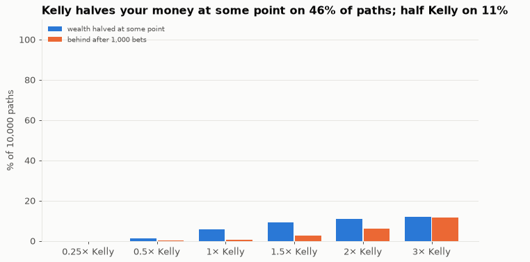
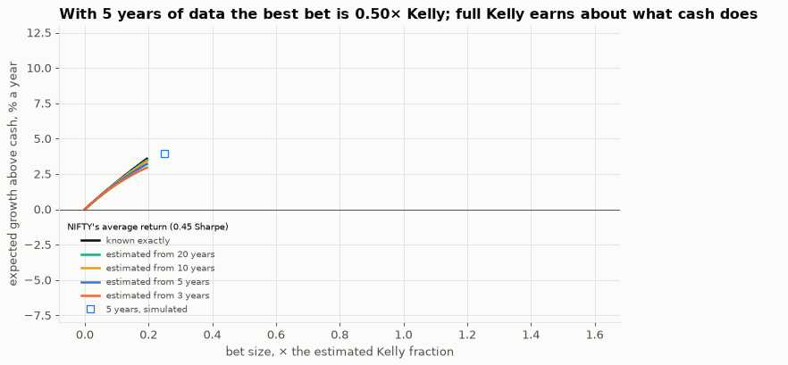
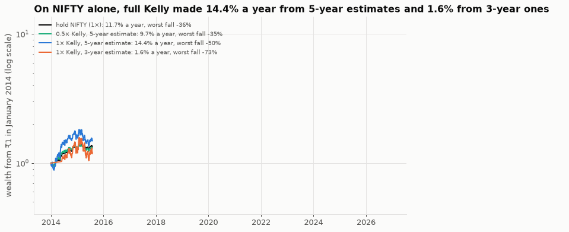
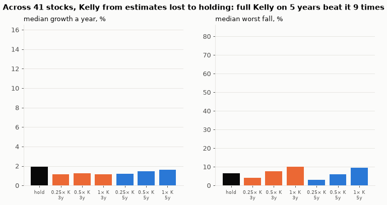

# Kelly Simulator

[](https://github.com/Dhirajdas18/kelly-simulator/actions/workflows/ci.yml)
[](https://dhirajdas18.github.io/kelly-simulator/)

How much of your money to put on each bet. Kelly's rule picks the fraction that makes wealth grow fastest;
this repo simulates what that buys and what it costs, then tests it on NSE data: estimation error,
drawdowns, many assets, real costs and sizing a trading signal.

**Live simulator: [dhirajdas18.github.io/kelly-simulator](https://dhirajdas18.github.io/kelly-simulator/)**.
Set the chance of winning, the payoff and the bet size, and watch 2,000 simulated players: the typical
one, the middle 80%, and how many halve their money along the way. Or pick any NIFTY 50 stock or ETF and a
window and see what Kelly's fraction was. It runs in your browser.

## Features

- [x] Repeated bets: growth against bet size, wealth paths, drawdown odds; in-browser simulator tested against Python through Node
- [x] Kelly for a stock: f* = (μ − r)/σ² on NIFTY and the NIFTY 50, with a live per-stock calculator
- [x] Estimation error: Kelly from an estimated edge, theory and walk-forward on NIFTY and 41 stocks
- [ ] Drawdowns and time under full and fractional Kelly
- [ ] Many assets: f = Σ⁻¹(μ − r), leverage and caps
- [ ] Rebalancing frequency, costs, margin and fat tails; Kelly against volatility targeting
- [ ] Sizing a trading signal from calibrated win rates and payoffs

## Findings

### 1. Half Kelly kept 75% of Kelly's growth and cut the chance of halving your money from 46% to 11%; double Kelly grew at zero

<a href="docs/img/bets_growth.png"><picture><source media="(prefers-reduced-motion: reduce)" srcset="docs/img/bets_growth.png"></picture></a>

A bet you win 55% of the time at even money (win ₹1 per ₹1 staked, else lose it), repeated 1,000 times,
betting a fixed fraction of current wealth each time. Kelly's fraction is the edge divided by the odds:
0.55 − 0.45 = 10% of wealth. What compounds is the average log of each bet's wealth multiplier, the growth
rate per bet; 10,000 simulated players per bet size, each starting with ₹1.

| Bet size | Fraction of wealth | Growth per bet | Typical ₹1 after 1,000 bets | Halved at some point | Behind at the end |
|---|---|---|---|---|---|
| ¼ Kelly | 2.5% | 0.22% | ₹8.96 | 0.7% | 0.3% |
| ½ Kelly | 5% | 0.38% | ₹43 | 11% | 0.9% |
| **Kelly** | **10%** | **0.50%** | **₹152** | **46%** | **5.8%** |
| 1.5× Kelly | 15% | 0.37% | ₹43 | 74% | 21% |
| 2× Kelly | 20% | −0.01% | ₹0.90 | 91% | 52% |
| 3× Kelly | 30% | −1.6% | ₹0.00 | 99.6% | 95% |

Typical = e^(average log wealth), within 4% of the median in every row.

- **The curve is flat at the top:** half Kelly gave up 25% of the growth for a quarter of the halving risk.
  1.5× Kelly grew exactly as fast as half Kelly (0.37% against 0.38%) with 6.6 times the chance of halving.
- **Double Kelly grows at zero:** betting 20% of wealth on a 55% coin left the typical player with ₹0.90 after
  1,000 bets, and half of them behind.
- **The theory's halving odds held:** in the limit of many small bets, the chance of ever falling to half is
  0.5^(2/c − 1) at c × Kelly: 12.5% at half Kelly and 50% at Kelly. The simulation gave 11% and 46%.

<table><tr>
<td><a href="docs/img/bets_paths.png"><picture><source media="(prefers-reduced-motion: reduce)" srcset="docs/img/bets_paths.png"></picture></a></td>
<td><a href="docs/img/bets_outcomes.png"><picture><source media="(prefers-reduced-motion: reduce)" srcset="docs/img/bets_outcomes.png"></picture></a></td>
</tr></table>

- **Wide spread even at Kelly (left):** the middle 80% of Kelly players ended between ₹2.70 and ₹10,122;
  half Kelly between ₹5.76 and ₹349.
- **The average misleads:** at double Kelly the average player ended with ₹81 lakh per ₹1 while the typical
  one had ₹0.90. 0.6% of paths finished above the average, and the top 1% held 99.8% of all the money (one
  path held 59%). Maximising the average says bet more; maximising typical growth says bet Kelly.

### 2. With hindsight, Kelly said hold NIFTY at 2.7× leverage from 2009 but 1.1× from 2007, and three-year windows ranged from −3.8 to 9.1

<a href="docs/img/stock_growth.png"><picture><source media="(prefers-reduced-motion: reduce)" srcset="docs/img/stock_growth.png"></picture></a>

For a stock, Kelly holds a fraction f of wealth in it and the rest in cash (f above 1 means borrowing).
With average return μ, volatility σ and a cash rate r (6.5% assumed throughout), wealth grows at
r + f(μ − r) − f²σ²/2 a year, which peaks at **f\* = (μ − r)/σ²**: the return above cash divided by the
variance. Annual figures come from calendar time. "Realised" replays the daily returns with the fraction
reset every day and cash or borrowing at 6.5% for the calendar days between closes; no costs yet.

| | Average return | Volatility | Sharpe | Kelly fraction | Growth: all cash / fully in / ½ Kelly / Kelly / 2× Kelly |
|---|---|---|---|---|---|
| NIFTY ETF, Jan 2009 – Nov 2026 | 13.9% | 16.5% | 0.45 | **2.74** | 6.3% / 12.5% / 14.1% / 16.7% / 6.1% |
| NIFTY index (no dividends), Sep 2007 – Nov 2026 | 11.1% | 20.2% | 0.23 | **1.12** | 6.3% / 9.0% / 8.3% / 9.0% / 6.6% |

- **The formula and the replay agree:** the realised curves sit on the formula's parabolas, and at twice
  Kelly growth fell back to about the cash rate (6.1% and 6.6%), as in section 1.
- **The answer depends on the start date:** the ETF's history starts in January 2009, after the 2008 fall;
  the index's in September 2007, before it. Kelly's fraction was 2.7 from one and 1.1 from the other. (The
  index leaves out dividends, so its return is understated; it still shows how much the start moves f\*.)
- **Leverage can wipe you out in a day:** the ETF's worst day was −10.2% (23 March 2020), so a fraction of
  9.8 would have lost everything at once.

<table><tr>
<td><a href="docs/img/stock_fstar.png"><picture><source media="(prefers-reduced-motion: reduce)" srcset="docs/img/stock_fstar.png"></picture></a></td>
<td><a href="docs/img/stock_rolling.png"><picture><source media="(prefers-reduced-motion: reduce)" srcset="docs/img/stock_rolling.png"></picture></a></td>
</tr></table>

- **Today's NIFTY 50, in hindsight (left):** 44 of the 50 stocks had a Kelly fraction above 1 since 2009 (or
  listing), 5 between 0 and 1 and one (JIOFIN, 3.3 years) below 0; the median was 1.7. These are today's
  members: stocks that dropped out of the index since 2009 are missing (survivorship bias).
- **Three years of data say almost anything (right):** Kelly's fraction from the past three years of NIFTY
  ETF returns ranged from −3.8 (March 2020) to 9.1 (May 2023); it was below 0 on 12% of days and above 2 on
  66%. Section 3 tests what sizing from such estimates does out of sample.

### 3. With 5 years of data the best bet was half the estimated Kelly; across 41 stocks, sizing from estimates lost to simply holding

<a href="docs/img/est_theory.png"><picture><source media="(prefers-reduced-motion: reduce)" srcset="docs/img/est_theory.png"></picture></a>

Kelly needs the average return, and an average estimated from T years of data is off by about σ/√T. That
noise passes straight into the Kelly fraction. Betting c times the estimate, the expected growth above cash
is c·S² − c²(S² + 1/T)/2 (S is the Sharpe ratio), which is largest at **c = S²T / (S²T + 1)**. For NIFTY's
Sharpe of 0.45 (2009–2026):

| Years of data | Best multiple of the estimate | Growth above cash at ½× | at 1× (full Kelly) |
|---|---|---|---|
| 3 | 0.38 | 3.5% | −6.5% |
| 5 | **0.50** | 5.1% | 0.2% |
| 10 | 0.67 | 6.4% | 5.2% |
| 20 | 0.80 | 7.0% | 7.7% |
| known exactly | 1.00 | 7.6% | 10.2% |

- **Half Kelly falls out of the maths:** with 5 years of data the best multiple is exactly 0.50, and full
  Kelly's expected growth is about the cash rate. A simulation (4,000 runs of 5 years) gave 5.2% above cash
  at half and −0.05% at full, matching the formula.

<table><tr>
<td><a href="docs/img/est_nifty.png"><picture><source media="(prefers-reduced-motion: reduce)" srcset="docs/img/est_nifty.png"></picture></a></td>
<td><a href="docs/img/est_stocks.png"><picture><source media="(prefers-reduced-motion: reduce)" srcset="docs/img/est_stocks.png"></picture></a></td>
</tr></table>

Walk-forward from January 2014 to November 2026: at each month end, estimate the average return and
volatility from the past 3 or 5 years only, hold c times Kelly's fraction (between 0 and a 3× cap) for the
next month, reset daily, borrowing or lending at 6.5%; no costs.

- **NIFTY alone (left):** holding 1× made 11.7% a year (worst fall −36%). Full Kelly from 5-year estimates
  made 14.4% (−50%), sitting at the 3× cap on 44% of days; from 3-year estimates it made 1.6% (−73%).
  Half Kelly from 5 years made 9.7% (−35%). One path can't separate skill from luck: the formula expects
  full Kelly on 5 years to earn about cash.
- **41 stocks with prices from January 2009 (right):** the median stock grew 15.7% a year held at 1× (worst
  fall −54%). Kelly from 5-year estimates: 9.9% at ¼× (−25%), 12.0% at ½× (−49%), 13.2% at 1× (−78%); it
  beat holding on 2, 4 and 9 of the 41. From 3-year estimates growth was 9.3–10.3% and falls up to −82%.
  These are today's NIFTY members, which favours holding them.

## Quick start

```bash
uv sync
uv run python scripts/fetch_data.py         # Yahoo Finance -> data/prices.parquet
uv run ks report bets                       # also: stock, estimation; charts -> out/
uv run python scripts/build_site.py         # simulator -> site/index.html
uv run pytest
```

## Design

- `src/ks/bets.py`: Kelly fraction, growth rate, simulated log-wealth paths, outcome summary and the
  continuous-limit halving probability.
- `src/ks/stock.py`: annual statistics from calendar time, Kelly's fraction and growth for a stock,
  realised growth of a daily-rebalanced levered position, and rolling Kelly estimates.
- `src/ks/estimation.py`: the best multiple of an estimated Kelly fraction, its expected growth, a Monte
  Carlo check, and a monthly walk-forward that sizes from past data only.
- `src/ks/kelly.js`, `simulator.html`, `stock.html`: the same in the browser with a seeded generator; a test runs them
  through Node against Python.
- `src/ks/data.py`: Yahoo prices for today's NIFTY 50, the index and two ETFs since 2007, with known errors
  repaired from `docs/data/yahoo_fixes.csv` (for the topics that use market data).
- `src/ks/reports.py`: README findings, reproducible with `ks report <topic>`.
- `src/ks/site.py`, `page.html`: the dashboard, one static page; no server.

MIT licence.
