# Kelly Simulator

[](https://github.com/Dhirajdas18/kelly-simulator/actions/workflows/ci.yml)
[](https://dhirajdas18.github.io/kelly-simulator/)

How much of your money to put on each bet. Kelly's rule picks the fraction that makes wealth grow fastest;
this repo simulates what that buys and what it costs, then tests it on NSE data: estimation error,
drawdowns, many assets, real costs and sizing a trading signal.

**Live simulator: [dhirajdas18.github.io/kelly-simulator](https://dhirajdas18.github.io/kelly-simulator/)**.
Set the chance of winning, the payoff and the bet size, and watch 2,000 simulated players: the typical
one, the middle 80%, and how many halve their money along the way. Or pick any NIFTY 50 stock or ETF and a
window and see what Kelly's fraction was. It runs in your browser.

## Features

- [x] Repeated bets: growth against bet size, wealth paths, drawdown odds; in-browser simulator tested against Python through Node
- [x] Kelly for a stock: f* = (μ − r)/σ² on NIFTY and the NIFTY 50, with a live per-stock calculator
- [x] Estimation error: Kelly from an estimated edge, theory and walk-forward on NIFTY and 41 stocks
- [x] Drawdowns and time under full and fractional Kelly
- [x] Many assets: f = Σ⁻¹(μ − r) on NIFTY, gold and the US, hindsight and walk-forward
- [x] Margin interest, ETF trading costs and rebalancing bands; Kelly against volatility targeting
- [x] Sizing a trading signal: calibration of a walk-forward model on the NIFTY 50, Kelly on raw and recalibrated probabilities

## Findings

### 1. Half Kelly keeps three quarters of the growth; double Kelly grows at zero

<a href="docs/img/bets_growth.png"><picture><source media="(prefers-reduced-motion: reduce)" srcset="docs/img/bets_growth.png">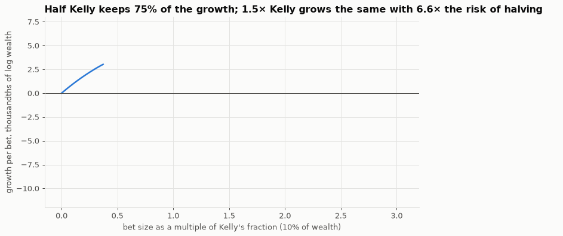</picture></a>
<table><tr>
<td><a href="docs/img/bets_paths.png"><picture><source media="(prefers-reduced-motion: reduce)" srcset="docs/img/bets_paths.png"></picture></a></td>
<td><a href="docs/img/bets_outcomes.png"><picture><source media="(prefers-reduced-motion: reduce)" srcset="docs/img/bets_outcomes.png"></picture></a></td>
</tr></table>

A bet you win 55% of the time at even money (win ₹1 per ₹1 staked, else lose it), repeated 1,000 times,
betting a fixed fraction of current wealth each time; 10,000 simulated players per bet size, each
starting with ₹1. Kelly's fraction is the edge divided by the odds: 0.55 − 0.45 = 10% of wealth. Growth
per bet is the average log of each bet's wealth multiplier, which is what compounds. Typical =
e^(average log wealth), within 4% of the median in every row.

| Bet size | Fraction of wealth | Growth per bet | Typical ₹1 after 1,000 bets | Halved at some point | Behind at the end |
|---|---|---|---|---|---|
| ¼ Kelly | 2.5% | 0.22% | ₹8.96 | 0.7% | 0.3% |
| ½ Kelly | 5% | 0.38% | ₹43 | 11% | 0.9% |
| **Kelly** | **10%** | **0.50%** | **₹152** | **46%** | **5.8%** |
| 1.5× Kelly | 15% | 0.37% | ₹43 | 74% | 21% |
| 2× Kelly | 20% | −0.01% | ₹0.90 | 91% | 52% |
| 3× Kelly | 30% | −1.6% | ₹0.00 | 99.6% | 95% |

- **The curve is flat at the top:** half Kelly kept 75% of Kelly's growth (gave up 25%) for a quarter of
  the halving risk, 11% against 46%. 1.5× Kelly grew about as fast as half Kelly (0.37% against 0.38%)
  with 6.6 times the chance of halving.
- **Double Kelly grows at zero:** betting 20% of wealth on a 55% coin left the typical player with ₹0.90 after
  1,000 bets, and half of them behind.
- **The theory's halving odds held:** in the limit of many small bets, the chance of ever falling to half is
  0.5^(2/c − 1) at c × Kelly: 12.5% at half Kelly and 50% at Kelly. The simulation gave 11% and 46%.
- **Wide spread even at Kelly (lower left):** the middle 80% of Kelly players ended between ₹2.70 and
  ₹10,122; half Kelly between ₹5.76 and ₹349.
- **The average misleads:** at double Kelly the average player ended with ₹81 lakh per ₹1 while the typical
  one had ₹0.90. 0.6% of paths finished above the average, and the top 1% held 99.8% of all the money (one
  path held 59%). Maximising the average says bet more; maximising typical growth says bet Kelly.

### 2. With hindsight, Kelly's leverage for NIFTY depends on the start date

<a href="docs/img/stock_growth.png"><picture><source media="(prefers-reduced-motion: reduce)" srcset="docs/img/stock_growth.png">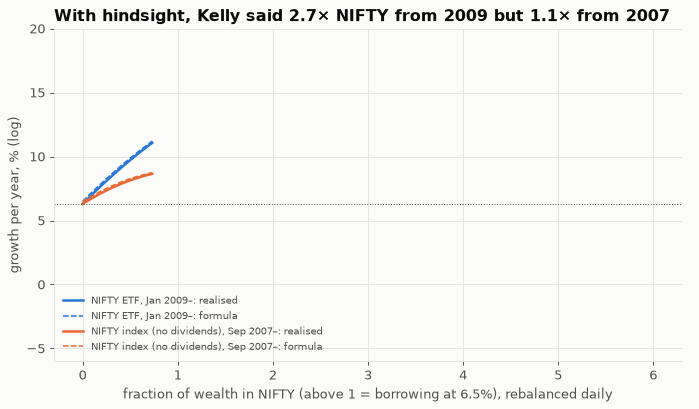</picture></a>
<table><tr>
<td><a href="docs/img/stock_fstar.png"><picture><source media="(prefers-reduced-motion: reduce)" srcset="docs/img/stock_fstar.png">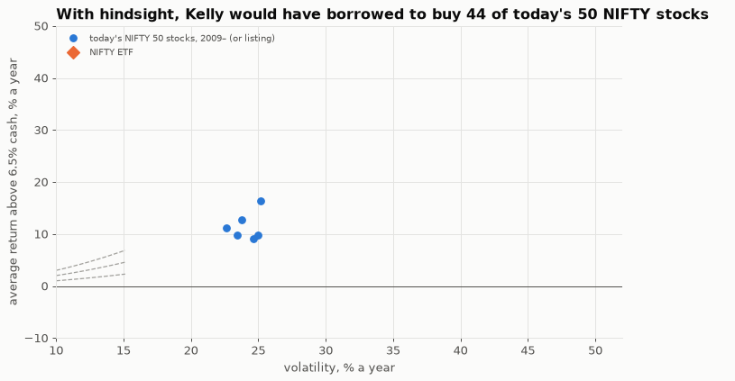</picture></a></td>
<td><a href="docs/img/stock_rolling.png"><picture><source media="(prefers-reduced-motion: reduce)" srcset="docs/img/stock_rolling.png">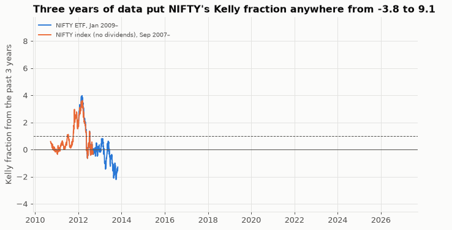</picture></a></td>
</tr></table>

For a stock, Kelly holds a fraction f of wealth in it and the rest in cash (f above 1 means borrowing).
With average return μ, volatility σ and a cash rate r (6.5% assumed throughout), wealth grows at
r + f(μ − r) − f²σ²/2 a year, which peaks at **f\* = (μ − r)/σ²**: the return above cash divided by the
variance. Annual figures come from calendar time. "Realised" replays the daily returns with the fraction
reset every day and cash or borrowing at 6.5% for the calendar days between closes; no costs yet.

| | Average return | Volatility | Sharpe | Kelly fraction | Growth: all cash / fully in / ½ Kelly / Kelly / 2× Kelly |
|---|---|---|---|---|---|
| NIFTY ETF, Jan 2009 – Nov 2026 | 13.9% | 16.5% | 0.45 | **2.74** | 6.3% / 12.5% / 14.1% / 16.7% / 6.1% |
| NIFTY index (no dividends), Sep 2007 – Nov 2026 | 11.1% | 20.2% | 0.23 | **1.12** | 6.3% / 9.0% / 8.3% / 9.0% / 6.6% |

- **The formula and the replay agree:** the realised curves sit on the formula's parabolas, and at twice
  Kelly growth fell back to about the cash rate (6.1% and 6.6%), as in section 1.
- **The answer depends on the start date:** 2.7× leverage from 2009 but 1.1× from 2007. The ETF's history
  starts in January 2009, after the 2008 fall; the index's in September 2007, before it. On the same
  index, starting in January 2009 instead of September 2007 moved Kelly's fraction from 1.12 to 2.25; the
  ETF from 2009 gave 2.74 (it includes dividends, and its volatility was 16.5% against the index's 17.7%).
- **Leverage can wipe you out in a day:** the ETF's worst day was −10.2% (23 March 2020), so a fraction of
  9.8 would have lost everything at once.
- **Today's NIFTY 50, in hindsight (lower left):** 44 of the 50 stocks had a Kelly fraction above 1 since
  2009 (or listing), 5 between 0 and 1 and one (JIOFIN, 3.3 years) below 0; the median was 1.7. These are
  today's members: stocks that dropped out of the index since 2009 are missing (survivorship bias).
- **Three years of data say almost anything (lower right):** Kelly's fraction from the past three years of
  NIFTY ETF returns ranged from −3.8 (March 2020) to 9.1 (May 2023); it was below 0 on 12% of days and
  above 2 on 66%. Section 3 tests what sizing from such estimates does out of sample.

### 3. With an estimated edge, bet half Kelly; across 41 stocks, holding still won

<a href="docs/img/est_theory.png"><picture><source media="(prefers-reduced-motion: reduce)" srcset="docs/img/est_theory.png"></picture></a>
<table><tr>
<td><a href="docs/img/est_nifty.png"><picture><source media="(prefers-reduced-motion: reduce)" srcset="docs/img/est_nifty.png"></picture></a></td>
<td><a href="docs/img/est_stocks.png"><picture><source media="(prefers-reduced-motion: reduce)" srcset="docs/img/est_stocks.png"></picture></a></td>
</tr></table>

An average return estimated from T years of data is off by about σ/√T, and that noise passes straight
into the Kelly fraction. Betting c times the estimate, the expected growth above cash is
c·S² − c²(S² + 1/T)/2 (S is the Sharpe ratio), largest at **c = S²T / (S²T + 1)**; the table uses NIFTY's
Sharpe of 0.45 (2009–2026). The walk-forward runs January 2014 to November 2026: at each month end,
estimate the average return and volatility from the past 3 or 5 years only, hold c times Kelly's fraction
(between 0 and a 3× cap) for the next month, reset daily, borrowing or lending at 6.5%; no costs.

| Years of data | Best multiple of the estimate | Growth above cash at ½× | at 1× (full Kelly) |
|---|---|---|---|
| 3 | 0.38 | 3.5% | −6.5% |
| 5 | **0.50** | 5.1% | 0.2% |
| 10 | 0.67 | 6.4% | 5.2% |
| 20 | 0.80 | 7.0% | 7.7% |
| known exactly | 1.00 | 7.6% | 10.2% |

- **Half Kelly falls out of the maths:** with 5 years of data the best multiple is 0.50, and full
  Kelly's expected growth is about the cash rate. A simulation (4,000 runs of 5 years) gave 5.2% above cash
  at half and −0.05% at full, matching the formula.
- **NIFTY alone (lower left):** holding 1× made 11.7% a year (worst fall −36%). Full Kelly from 5-year
  estimates made 14.4% (−50%), sitting at the 3× cap on 44% of days; from 3-year estimates it made 1.6%
  (−73%). Half Kelly from 5 years made 9.7% (−35%). One path can't separate skill from luck: the formula
  expects full Kelly on 5 years to earn about cash.
- **41 stocks with prices from January 2009 (lower right):** the median stock grew 15.7% a year held at 1×
  (worst fall −54%). Kelly from 5-year estimates: 9.9% at ¼× (−25%), 12.0% at ½× (−49%), 13.2% at 1×
  (−78%); it beat holding on 2, 4 and 9 of the 41. From 3-year estimates growth was 9.3–10.3% and falls up
  to −82%.
- **Survivorship favours holding:** these are today's NIFTY members, which favours holding them.

### 4. Even with a known edge, Kelly takes over a century to win reliably

<a href="docs/img/dd_ahead.png"><picture><source media="(prefers-reduced-motion: reduce)" srcset="docs/img/dd_ahead.png">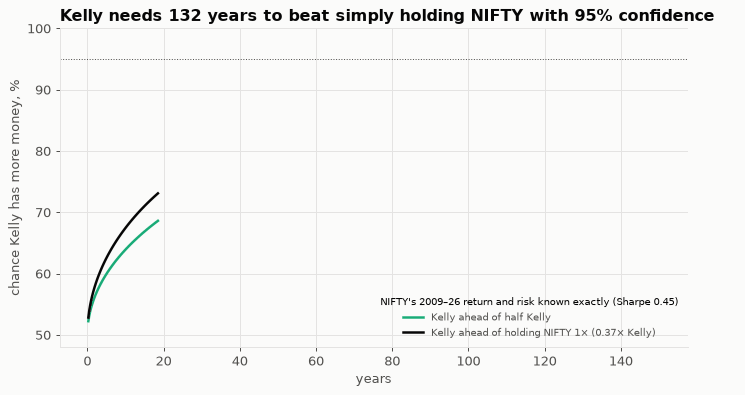</picture></a>
<table><tr>
<td><a href="docs/img/dd_depth.png"><picture><source media="(prefers-reduced-motion: reduce)" srcset="docs/img/dd_depth.png">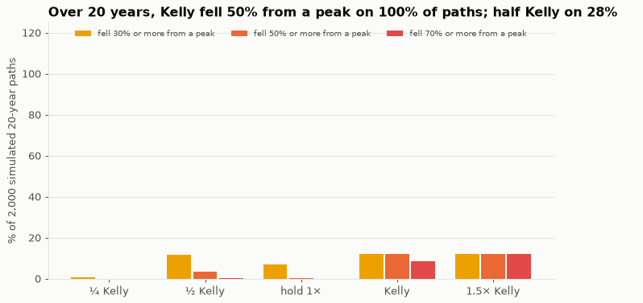</picture></a></td>
<td><a href="docs/img/dd_nifty.png"><picture><source media="(prefers-reduced-motion: reduce)" srcset="docs/img/dd_nifty.png">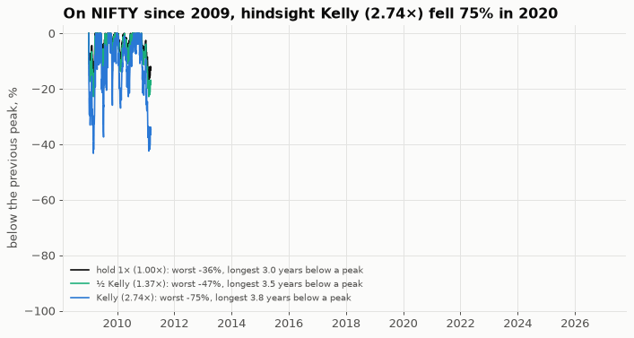</picture></a></td>
</tr></table>

This section assumes the best case for Kelly: NIFTY's 2009–2026 average return (13.9%) and volatility
(16.5%) are known exactly, so Kelly's fraction is 2.74 and holding NIFTY fully invested is 0.37× Kelly. Two
bet sizes c1 > c2 on the same asset end up a normally distributed amount apart, so the chance the bigger one
is ahead after T years is **Φ(√T · S · (1 − (c1 + c2)/2))**, with S the Sharpe ratio (0.45). Drawdowns
come from 2,000 simulated 20-year paths and from NIFTY's actual path.

| Kelly ahead of… | after 5 years | 10 | 20 | 50 | years for 90% | years for 95% |
|---|---|---|---|---|---|---|
| half Kelly | 60% | 64% | 69% | 79% | 129 | 213 |
| holding NIFTY 1× | 63% | 67% | 74% | 84% | 80 | 132 |

| 2,000 simulated 20-year paths | ¼ Kelly | ½ Kelly | hold 1× | Kelly | 1.5× Kelly |
|---|---|---|---|---|---|
| fell 50% or more from a peak | 0% | 28% | 3% | **99.6%** | 100% |
| fell 70% or more | 0% | 1% | 0% | **70%** | 99% |
| median worst fall | −20% | −44% | −32% | −76% | −92% |
| median longest time below a peak | 2.5 years | 3.8 | 3.2 | 5.9 | 8.0 |
| median growth a year | 11.0% | 14.2% | 12.6% | 16.8% | 14.4% |

- **The long run is very long:** Kelly is the fastest-growing bet only in the long run. It needs 132 years
  to beat simply holding NIFTY with 95% confidence, and after 20 years it was still behind half Kelly 31%
  of the time (simulated: 30% of 2,000 paths, using the same market shocks for each bet size).
- **The price of the extra growth (lower left):** Kelly added 2.6 points a year over half Kelly at the
  median, and 99.6% of Kelly paths (1,992 of 2,000) halved from a peak at least once within 20 years; 70%
  lost 70% or more.
- **On NIFTY's actual path (lower right):** at the hindsight Kelly fraction of 2.74, daily rebalanced with
  borrowing at 6.5%, the worst fall was −75% (23 March 2020) against −47% at half Kelly and −36% holding 1×.
  The longest spells below a previous peak were 3.8, 3.5 and 3.0 years.

### 5. Hindsight Kelly wanted 8× leverage; out of sample, equal thirds won

<a href="docs/img/multi_walk.png"><picture><source media="(prefers-reduced-motion: reduce)" srcset="docs/img/multi_walk.png">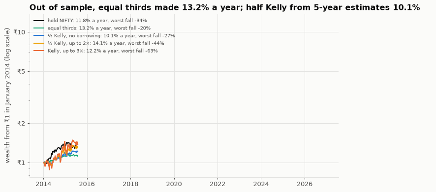</picture></a>
<table><tr>
<td><a href="docs/img/multi_weights.png"><picture><source media="(prefers-reduced-motion: reduce)" srcset="docs/img/multi_weights.png">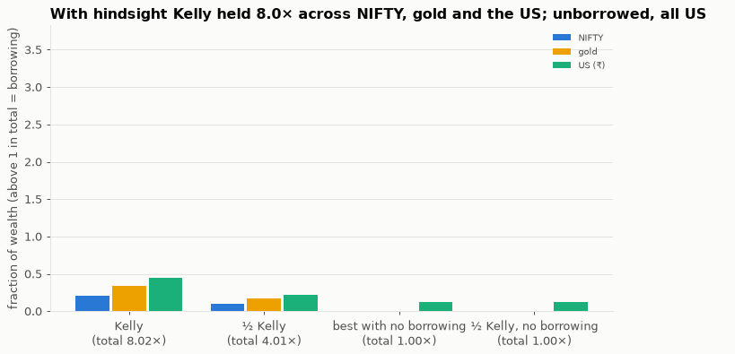</picture></a></td>
<td><a href="docs/img/multi_growth.png"><picture><source media="(prefers-reduced-motion: reduce)" srcset="docs/img/multi_growth.png">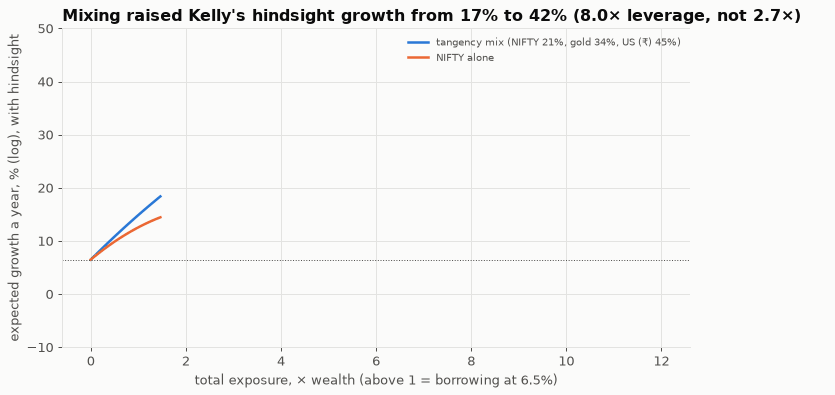</picture></a></td>
</tr></table>

With several assets Kelly's weights are **w = Σ⁻¹(μ − r)**: the covariance matrix inverted, times each
asset's return above cash. Scaled to add up to 1, they are the tangency portfolio, the highest-Sharpe mix;
Kelly holds that mix with leverage equal to the weights' total, and its growth is r + ½·(the mix's Sharpe)².
Three assets in rupees, weekly returns January 2009 to November 2026 (934 weeks): NIFTY (ETF), gold (ETF)
and the US market (S&P 500 total return × USD/INR, both from Yahoo); cash at 6.5%. Walk-forward (top
chart): each month, the best long-only weights with total at most the cap, estimated from the past 5 years
of weekly returns only, then multiplied by ½ or 1 (half Kelly holds half the capped position, the rest in
cash), held through the next month; no costs.

| 2009–2026 | NIFTY | gold | US (₹) |
|---|---|---|---|
| average return / volatility | 13.9% / 16.5% | 12.4% / 14.3% | 18.4% / 16.5% |
| correlation with NIFTY | — | −0.06 | 0.33 |
| hindsight Kelly weight | 1.64 | 2.73 | 3.68 |

| January 2014 – November 2026 | Growth a year | Worst fall | Average weights (NIFTY / gold / US) |
|---|---|---|---|
| hold NIFTY | 11.8% | −34% | 1 / 0 / 0 |
| **equal thirds**, rebalanced monthly | **13.2%** | **−20%** | 0.33 / 0.33 / 0.33 |
| ½ Kelly, no borrowing (total 0.5) | 8.9% | −14% | 0.03 / 0.04 / 0.43 |
| ½ Kelly, up to 2× (total 1.0) | 10.1% | −27% | 0.08 / 0.13 / 0.78 |
| Kelly, up to 3× | 12.2% | −63% | 0.33 / 0.53 / 2.14 |

- **Hindsight Kelly borrowed 7 times its wealth (lower charts):** across NIFTY, gold and the US the weights
  total 8.0×. The tangency mix (NIFTY 20%, gold 34%, US 46%) had a Sharpe of 0.85 against NIFTY's 0.45,
  so the formula's best growth rose from 17% (NIFTY alone at 2.7×) to 42% a year. Without borrowing, the
  best hindsight mix was 100% US.
- **At the same exposure, the plain mix won out of sample:** fully invested, equal thirds grew 3.1 points a
  year faster than half Kelly's estimated weights (½ Kelly up to 2×, which held 1.0 on average), with a
  shallower worst fall. Those weights averaged 78% in the US.
- **Leverage bought little:** full Kelly at up to 3× grew 1.0 point less than equal thirds and fell −63%.

### 6. Margin interest ends the case for leverage; volatility targeting cut the worst fall

<a href="docs/img/fric_spread.png"><picture><source media="(prefers-reduced-motion: reduce)" srcset="docs/img/fric_spread.png">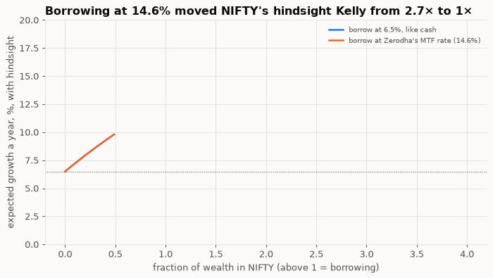</picture></a>
<table><tr>
<td><a href="docs/img/fric_costs.png"><picture><source media="(prefers-reduced-motion: reduce)" srcset="docs/img/fric_costs.png">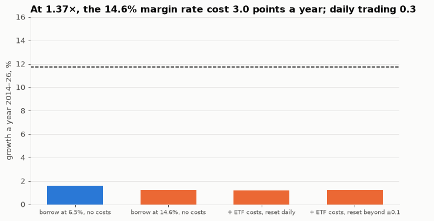</picture></a></td>
<td><a href="docs/img/fric_voltarget.png"><picture><source media="(prefers-reduced-motion: reduce)" srcset="docs/img/fric_voltarget.png">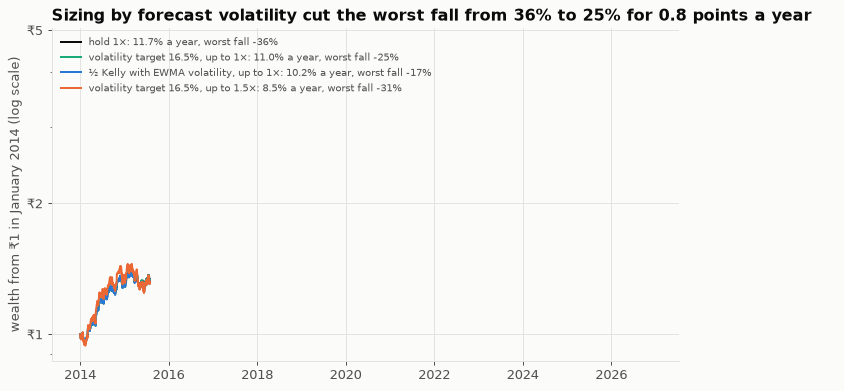</picture></a></td>
</tr></table>

Sections 2–5 borrowed at the same 6.5% that cash earns. Zerodha's margin trading facility (MTF) charges 0.04%
a day on the funded amount, about 14.6% a year, plus 0.3% or ₹20 per order, whichever is lower
([Zerodha support](https://support.zerodha.com/category/trading-and-markets/margins/margin-trading-facility/articles/interest-calculation-for-mtf),
checked November 2026). With borrowing dearer than lending, the growth curve has a kink at 1: below it the
cash rate applies, above it the margin rate. Kelly's fraction is (μ − 6.5%)/σ² if that is under 1,
(μ − 14.6%)/σ² if that is over 1, and exactly 1 in between. The replays use the NIFTY ETF, January 2014 –
November 2026, ₹10 lakh, with ETF delivery costs: STT 0.001% on sells only, stamp duty 0.015% on buys,
exchange and SEBI charges with GST, ₹15.93 DP charge per sell day
([Zerodha charges](https://zerodha.com/charges), [STT on ETFs](https://support.zerodha.com/category/account-opening/charges-at-zerodha/articles/stt-etfs)),
plus an assumed 0.05% slippage per side. Spare cash earns 6.5%.

| 2014–2026 | Growth a year | Worst fall | Volatility | Average fraction | Trading costs a year |
|---|---|---|---|---|---|
| hold 1× | 11.7% | −36% | 14.4% | 1.00 | 0 |
| 1.18× (½ Kelly from 2009–13), borrow at 6.5%, no costs | 12.5% | −42% | 17.0% | 1.18 | 0 |
| 1.18×, borrow at 14.6%, no costs | 11.0% | −42% | 17.0% | 1.18 | 0 |
| 1.18×, 14.6% and costs, reset daily | 10.8% | −42% | 17.0% | 1.18 | 0.21% |
| 1.18×, 14.6% and costs, reset beyond ±0.1 | 11.0% | −43% | 17.0% | 1.17 | 0.00% |
| **volatility target 21%, up to 1×** | **11.2%** | **−28%** | 12.7% | 0.94 | 0.01% |
| ½ Kelly with EWMA volatility, up to 1× | 10.2% | −17% | 11.0% | 0.85 | 0.10% |
| volatility target 21%, up to 1.5× | 8.7% | −36% | 17.9% | 1.38 | 0.12% |

- **Never borrow for NIFTY:** NIFTY's 13.9% average return (2009–2026) is below the 14.6% margin rate, so
  every borrowed rupee lowers expected growth. Kelly's fraction fell from 2.7× to exactly 1 (hindsight
  growth 12.6% instead of 16.7% at 2.7×).
- **Fixed inputs come from before the test period only:** from January 2009 to December 2013 NIFTY
  averaged 16.9% with 21.0% volatility, so half Kelly was 1.18× and the volatility target is 21%.
- **The margin rate was the big friction (lower left):** at 1.18× it cost 1.5 points a year and left growth
  below simply holding. Trading costs were small for an ETF: resetting every day cost 0.21% a year, and a
  ±0.1 band brought that to almost nothing.
- **Volatility targeting cut the worst fall from −36% to −28% (lower right):** each day hold 21% ÷
  tomorrow's EWMA volatility forecast (λ 0.94, from past returns only), at most 1×, trading only when the
  gap exceeds 0.1. It grew 0.5 points a year slower than holding.
- **Other variants did not improve on it:** half Kelly with the EWMA forecast and the past five years'
  average return grew 10.2% with a worst fall of −17%. Allowing borrowing at the margin rate (up to 1.5×)
  made volatility targeting worse on growth and no better on the worst fall.

### 7. An overconfident model bets too much; a real signal had no edge to size

<a href="docs/img/sig_reliability.png"><picture><source media="(prefers-reduced-motion: reduce)" srcset="docs/img/sig_reliability.png">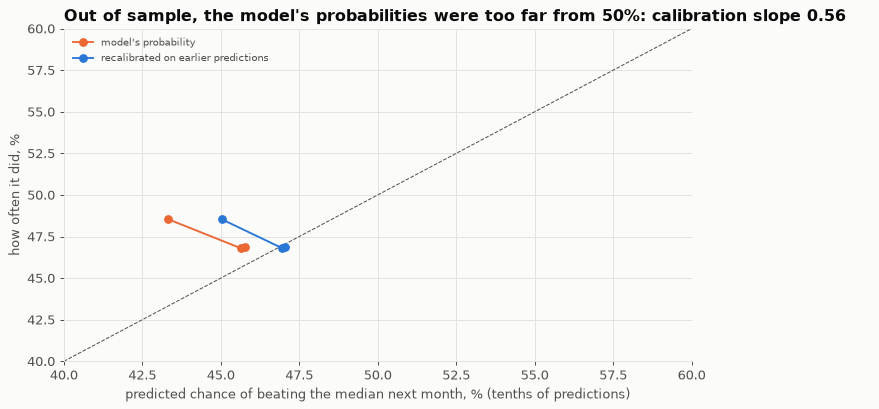</picture></a>
<table><tr>
<td><a href="docs/img/sig_theory.png"><picture><source media="(prefers-reduced-motion: reduce)" srcset="docs/img/sig_theory.png">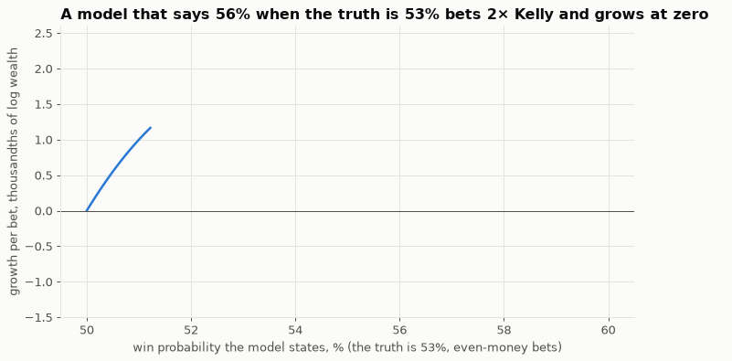</picture></a></td>
<td><a href="docs/img/sig_sizing.png"><picture><source media="(prefers-reduced-motion: reduce)" srcset="docs/img/sig_sizing.png">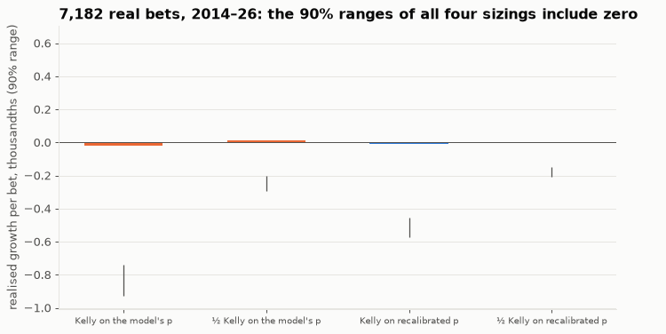</picture></a></td>
</tr></table>

Kelly needs the true chance of winning; a model supplies an estimate. Calibration measures the gap: fit
P(win) = sigmoid(a + slope · logit(p)) on past predictions; a slope of 1 is calibrated, and below 1 the
model is overconfident by about 1/slope. The signal: each month end since 2010, for today's NIFTY 50
stocks, the chance a stock beats the median of the same stocks next month, from a logistic model of three
ranks (12-to-1-month momentum, last month's return and 60-day volatility), refitted every month on earlier
months only (9,212 stock-months; out of sample from January 2013, 7,698 predictions). Sizing (lower right):
every stock-month from 2014 to November 2026 treated as an even-money bet on beating the median (win the
stake or lose it), staked by Kelly when the probability is above 50%, scored on what actually happened.
Ranges are 90% bootstraps over whole months, since a month's bets move together.

| 7,182 bets, 2014–2026 | Growth per bet, thousandths (90% range) | Average stake | Bets placed |
|---|---|---|---|
| Kelly on the model's p | −0.18 (−0.93 to 0.63) | 1.9% | 40% |
| ½ Kelly on the model's p | +0.09 (−0.29 to 0.47) | 1.0% | 40% |
| Kelly on recalibrated p | −0.08 (−0.57 to 0.41) | 1.1% | 36% |
| ½ Kelly on recalibrated p | +0.03 (−0.21 to 0.29) | 0.6% | 36% |

- **Overstating the edge 2× bets 2× Kelly (lower left):** for an even-money bet Kelly stakes 2p − 1, so a
  model whose probabilities sit twice as far from 50% as the truth stakes twice Kelly. If the truth is 53%,
  Kelly stakes 6% and grows 1.80 thousandths per bet; a model saying 56% stakes 12% and grows at −0.02, and
  one saying 60% at −8.2.
- **The real signal was that overconfident (top):** out-of-sample calibration slope 0.56. The tenth of
  predictions averaging 54.9% beat the median 52.3% of the time; the bottom tenth, 43.3%, did so 48.5% of
  the time. Recalibrating each month on earlier predictions only pulled them toward 50% (top tenth 53.2%).
  The walk-forward slope ranged from 0.46 to 1.22 as it was re-estimated.
- **Almost no skill:** the Brier score was 0.24983, against 0.24997 for always predicting the base rate.
- **Survivorship is reduced, not ruled out:** using the median of the same stocks as the bar removes the
  survivors' average outperformance from the label (49.4% of stock-months beat it); survivorship could still
  affect which features look useful, which this test does not rule out.
- **Nothing to size, and no sizing beat zero:** every range includes zero. Recalibration and halving shrank
  the stakes and the swings (the range narrowed from 1.56 to 0.50 thousandths) but couldn't create an edge
  the model didn't have.

## Quick start

```bash
uv sync
uv run python scripts/fetch_data.py         # Yahoo Finance -> data/prices.parquet
uv run ks report bets                       # also: stock, estimation, drawdown, multi, frictions, signal
uv run python scripts/build_site.py         # simulator -> site/index.html
uv run pytest
```

## Design

- `src/ks/bets.py`: Kelly fraction, growth rate, simulated log-wealth paths, outcome summary and the
  continuous-limit halving probability.
- `src/ks/stock.py`: annual statistics from calendar time, Kelly's fraction and growth for a stock,
  realised growth of a daily-rebalanced levered position, and rolling Kelly estimates.
- `src/ks/estimation.py`: the best multiple of an estimated Kelly fraction, its expected growth, a Monte
  Carlo check, and a monthly walk-forward that sizes from past data only.
- `src/ks/drawdown.py`: drawdowns, longest time below a peak, the chance one bet size is ahead of
  another after T years (and the years needed for a given confidence), and simulated wealth paths.
- `src/ks/multi.py`: Kelly weights Σ⁻¹(μ − r), growth, the tangency portfolio, long-only Kelly with a
  leverage cap, and a monthly walk-forward on weekly returns.
- `src/ks/frictions.py`: Kelly with a borrowing spread, Zerodha ETF and MTF costs, EWMA volatility
  forecasts, and a daily replay with drift, rebalancing bands, costs and interest.
- `src/ks/signal.py`: the monthly stock panel, logistic regression, walk-forward probabilities,
  calibration slope and recalibration, and realised growth of even-money bets.
- `src/ks/kelly.js`, `simulator.html`, `stock.html`, `signal.html`: the same in the browser with a seeded generator; a test runs them
  through Node against Python.
- `src/ks/data.py`: Yahoo prices for today's NIFTY 50, the index and two ETFs since 2007, with known errors
  repaired from `docs/data/yahoo_fixes.csv`; the S&P 500 total-return index and USD/INR kept in a separate
  table (US calendar), joined on weekly closes.
- `src/ks/reports.py`: README findings, reproducible with `ks report <topic>`.
- `src/ks/site.py`, `page.html`: the dashboard, one static page; no server.

MIT licence.
