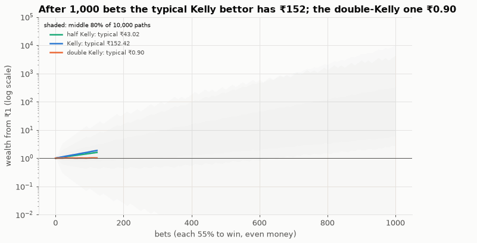

# Kelly Simulator

[](https://github.com/Dhirajdas18/kelly-simulator/actions/workflows/ci.yml)
[](https://dhirajdas18.github.io/kelly-simulator/)

How much of your money to put on each bet. Kelly's rule picks the fraction that makes wealth grow fastest;
this repo simulates what that buys and what it costs, then tests it on NSE data: estimation error,
drawdowns, many assets, real costs and sizing a trading signal.

**Live simulator: [dhirajdas18.github.io/kelly-simulator](https://dhirajdas18.github.io/kelly-simulator/)**.
Set the chance of winning, the payoff and the bet size, and watch 2,000 simulated players: the typical
one, the middle 80%, and how many halve their money along the way. It runs in your browser.

## Features

- [x] Repeated bets: growth against bet size, wealth paths, drawdown odds; in-browser simulator tested against Python through Node
- [ ] Kelly for a stock: f* = (μ − r)/σ² on NIFTY and the NIFTY 50
- [ ] Estimation error: Kelly from an estimated edge, walk-forward
- [ ] Drawdowns and time under full and fractional Kelly
- [ ] Many assets: f = Σ⁻¹(μ − r), leverage and caps
- [ ] Rebalancing frequency, costs, margin and fat tails; Kelly against volatility targeting
- [ ] Sizing a trading signal from calibrated win rates and payoffs

## Findings

### 1. Half Kelly kept 75% of Kelly's growth and cut the chance of halving your money from 46% to 11%; double Kelly grew at zero

<a href="docs/img/bets_growth.png"><picture><source media="(prefers-reduced-motion: reduce)" srcset="docs/img/bets_growth.png"></picture></a>

A bet you win 55% of the time at even money (win ₹1 per ₹1 staked, else lose it), repeated 1,000 times,
betting a fixed fraction of current wealth each time. Kelly's fraction is the edge divided by the odds:
0.55 − 0.45 = 10% of wealth. What compounds is the average log of each bet's wealth multiplier, the growth
rate per bet; 10,000 simulated players per bet size, each starting with ₹1.

| Bet size | Fraction of wealth | Growth per bet | Typical ₹1 after 1,000 bets | Halved at some point | Behind at the end |
|---|---|---|---|---|---|
| ¼ Kelly | 2.5% | 0.22% | ₹8.96 | 0.7% | 0.3% |
| ½ Kelly | 5% | 0.38% | ₹43 | 11% | 0.9% |
| **Kelly** | **10%** | **0.50%** | **₹152** | **46%** | **5.8%** |
| 1.5× Kelly | 15% | 0.37% | ₹43 | 74% | 21% |
| 2× Kelly | 20% | −0.01% | ₹0.90 | 91% | 52% |
| 3× Kelly | 30% | −1.6% | ₹0.00 | 99.6% | 95% |

Typical = e^(average log wealth), within 4% of the median in every row.

- **The curve is flat at the top:** half Kelly gave up 25% of the growth for a quarter of the halving risk.
  1.5× Kelly grew exactly as fast as half Kelly (0.37% against 0.38%) with 6.6 times the chance of halving.
- **Double Kelly grows at zero:** betting 20% of wealth on a 55% coin left the typical player with ₹0.90 after
  1,000 bets, and half of them behind.
- **The theory's halving odds held:** in the limit of many small bets, the chance of ever falling to half is
  0.5^(2/c − 1) at c × Kelly: 12.5% at half Kelly and 50% at Kelly. The simulation gave 11% and 46%.

<table><tr>
<td><a href="docs/img/bets_paths.png"><picture><source media="(prefers-reduced-motion: reduce)" srcset="docs/img/bets_paths.png"></picture></a></td>
<td><a href="docs/img/bets_outcomes.png"><picture><source media="(prefers-reduced-motion: reduce)" srcset="docs/img/bets_outcomes.png"></picture></a></td>
</tr></table>

- **Wide spread even at Kelly (left):** the middle 80% of Kelly players ended between ₹2.70 and ₹10,122;
  half Kelly between ₹5.76 and ₹349.
- **The average misleads:** at double Kelly the average player ended with ₹81 lakh per ₹1 while the typical
  one had ₹0.90. 0.6% of paths finished above the average, and the top 1% held 99.8% of all the money (one
  path held 59%). Maximising the average says bet more; maximising typical growth says bet Kelly.

## Quick start

```bash
uv sync
uv run ks report bets                       # charts -> out/
uv run python scripts/build_site.py         # simulator -> site/index.html
uv run pytest
```

## Design

- `src/ks/bets.py`: Kelly fraction, growth rate, simulated log-wealth paths, outcome summary and the
  continuous-limit halving probability.
- `src/ks/kelly.js`, `simulator.html`: the same in the browser with a seeded generator; a test runs them
  through Node against Python.
- `src/ks/data.py`: Yahoo prices for today's NIFTY 50, the index and two ETFs since 2007, with known errors
  repaired from `docs/data/yahoo_fixes.csv` (for the topics that use market data).
- `src/ks/reports.py`: README findings, reproducible with `ks report <topic>`.
- `src/ks/site.py`, `page.html`: the dashboard, one static page; no server.

MIT licence.
